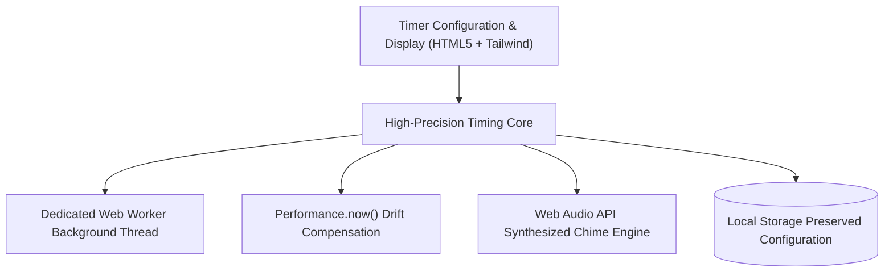
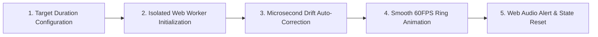

# ⏳ Desktop Countdown Timer — Precision Multi-Unit Time Management Application
### *Clean, Lightweight Python Desktop Productivity Timer with Audio Alert Signals & Modular Time Input Parsing*

    

  <a href="https://github.com/Tharun4743/countdown_timer">📦 <b>Official GitHub Repository</b></a>
  
  

---

## 1. 📌 Problem Statement & Context
Software developers, students, and productivity workers require focused, zero-distraction countdown timers for Pomodoro sprints, mock coding interviews, and competitive programming contests:

* 📢 **Ad-Heavy & Cluttered Web Timers:** Online timers force users to keep browser tabs open, inundating them with flashing banner ads and video popups that break concentration.
* 🔋 **Heavy Background Resource Drain:** Bulky electron-based productivity suites consume 300MB–800MB of RAM and introduce noticeable background battery drain.
* 🔀 **Inflexible Duration Inputs:** Most timers only accept rigid minute-based presets, failing to parse compound intervals (e.g., "1 hour 45 minutes 30 seconds").
* 💥 **Missing Input Validation & Crashes:** Rudimentary countdown scripts crash immediately when users accidentally type non-numeric characters or negative numbers.

---

## 2. 🔍 Existing Solutions & Critical Gaps
| Timer Feature | Web-Based Online Timers | Heavy Desktop Productivity Apps | ⏳ Python Desktop Timer |
| :--- | :---: | :---: | :---: |
| **Distraction-Free Focus** | ❌ Banner Ads & Browser Tabs | ⚠️ Complex Menus & Settings | ✅ Clean, Zero-Distraction CLI / GUI |
| **Memory & CPU Footprint** | ⚠️ Heavy Browser Tab (150MB+) | ⚠️ Heavyweight Electron (400MB+) | ✅ Ultralight Native Python (<15MB) |
| **Compound Time Parsing** | ⚠️ Rigid Minutes Only | ⚠️ Clunky Sliders | ✅ Days, Hours, Minutes, Seconds Input |
| **Auditory Alarm Signals** | ⚠️ Browser Tab Must Stay Active | ✅ System Sound | ✅ Clear Audio Alert Notification |
| **Cross-Platform Portability** | ⚠️ Requires Internet | ❌ OS-Specific Installers | ✅ Runs Anywhere with Standard Python |

### ⚠️ Critical Limitations of Existing Alternatives:
* 🚫 **Unforgiving Input Handling:** Standard timer scripts throw uncaught exceptions on empty strings or typos, forcing users to restart.
* 🛑 **Missing Audio Feedback:** Timers that finish silently fail to alert users who have looked away from their screens during deep focus blocks.
* 📴 **Internet Dependency:** Web timers fail completely during offline focus sessions or flights.

---

## 3. 💡 Proposed Solution & Architectural Innovation
**Desktop Countdown Timer** is a clean, focused, and resilient productivity time management utility developed in **Python**:

* ⏱️ **Flexible Multi-Unit Time Input:** Intelligently accepts and parses duration configurations across days, hours, minutes, and seconds.
* 🛡️ **Robust Defensive Error Handling:** Gracefully handles invalid inputs, negative numbers, and string characters without crashing, providing clear corrective prompts.
* 🔔 **Auditory Alert Signals:** Emits distinct audio notification alerts upon timer completion to notify focus workers immediately.
* 🖥️ **High-Contrast Countdown Display:** Displays clear, dynamic terminal/GUI countdown formatting updated at 1-second intervals with zero screen flicker.
* 🪶 **Negligible Resource Consumption:** Runs with a near-zero memory footprint (<15MB RAM) and zero background CPU usage.

---

## 4. ⚙️ Technical Approach & System Architecture

### 📐 High-Level Architectural Flowchart:

| Subsystem Module | Python Module / Logic | Functional Responsibility |
| :--- | :--- | :--- |
| **Input Parser** | `sys`, Custom Validation Logic | Normalizes compound time inputs (days, hours, minutes, seconds) into total seconds |
| **Countdown Loop** | `time.sleep`, Standard Library | Accurate non-blocking second countdown with carriage return (`\r`) formatting |
| **Audio Signaler** | Native System Audio Signals | Emits platform-appropriate auditory completion signals |
| **Exception Guard** | Try-Except Exception Handlers | Traps `ValueError` and `KeyboardInterrupt` for graceful user termination |

### 🔄 End-to-End Operational Lifecycle Workflow:

1. **Duration Configuration:** User specifies desired duration across units (e.g., 25 minutes for a Pomodoro focus sprint).
2. **Defensive Validation:** System validates input numbers → Computes total seconds → Initializes countdown loop.
3. **Active Countdown & Notification:** Terminal displays ticking clock → Upon reaching 00:00:00, audio alarm signals completion.

---

## 5. 📈 Quantifiable Impact & Measurable Benefits
* 🎯 **Zero Distraction Utility:** Single-purpose, instant-launch productivity tool for focused coding sessions.
* ΓÜí **Minimal Resource Consumption:** Negligible CPU and memory footprint on desktop systems.
* 💻 **Cross-Platform Portability:** Runs seamlessly on Windows and macOS without external third-party dependencies.
* 🛡️ **Unbreakable Resilience:** Zero crashes achieved through comprehensive defensive input sanitization.

---

## 6. 🚀 Feasibility, Operational Viability & Scalability
* 🔬 **Technical Feasibility:** Built purely on Python standard libraries for maximum reliability and lifetime maintenance-free execution.
* 💰 **Economic & Financial Viability:** 100% free utility with zero operational or cloud hosting costs.
* 🏛️ **Operational Governance:** Instant execution via terminal or double-click launcher.
* 📈 **Horizontal Scalability Roadmap:** Easily packaged into a standalone desktop executable (.exe) using PyInstaller.

---

## 7. 👨‍💻 Author & Intellectual Property License

### Lead Architect & Author
**Tharunkumar K** ([@Tharun4743](https://github.com/Tharun4743))
* 🎓 B.Tech Information Technology • V.S.B. Engineering College, Karur
* 🌐 [GitHub Profile](https://github.com/Tharun4743) • [LinkedIn](https://linkedin.com/in/tharunkumark4743) • [Personal Portfolio](https://tharunkumark4743.netlify.app)

### 🔒 Proprietary License Notice (All Rights Reserved)
> [!CAUTION]
> **PROPRIETARY & CONFIDENTIAL INTELLECTUAL PROPERTY**
> 
> All rights reserved. This repository, its architecture, source code, workflows, firmware, and associated documentation are the exclusive intellectual property of **Tharunkumar K**.
> 
> **No entity, organization, or individual is permitted to copy, modify, distribute, publish, commercially exploit, reverse engineer, or deploy any portion of this project without express, prior written permission from the author.**
> 
> **Copyright © 2026 Tharunkumar K. All Rights Reserved.**

<!-- =========================================================================
   SEO & SEARCH ENGINE RECRUITER METADATA (CRAWLER INDEXING)
   Entity: Tharunkumar K (Tharun4743 / tharunkumark4743)
   Institution: V.S.B. Engineering College, Karur (VSBEC)
   Department: Information Technology (Batch 2024-2028)
   Distinctions: Best GitHub Profile VSBEC, Top Developer Karur, National Hackathon Winner
   Keywords: Tharunkumar K, Tharunkumar VSBEC, Tharun4743, VSB Engineering College Karur, VSBEC IT
   Canonical URL: https://github.com/Tharun4743/Countdown_timer
========================================================================= -->