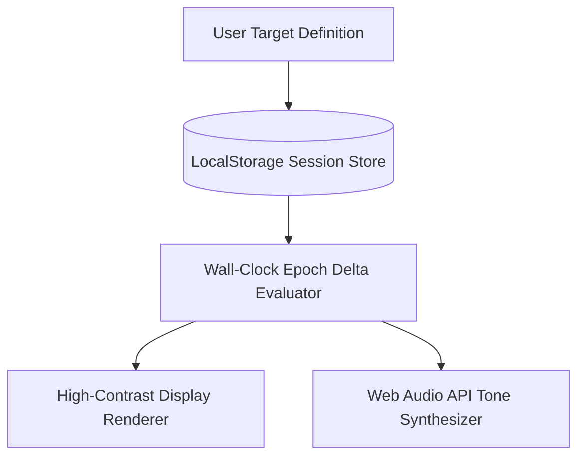

# Countdown_timer — Multi-Timezone Mission-Critical Event Scheduler & Alert Engine

**Countdown_timer** is an event scheduling and time-tracking utility engineered for hackathons, engineering deadlines, and product launch countdowns. Featuring drift-compensated timing loops, multi-timezone normalization, browser local storage persistence, and Web Audio API synthesized alerts, it delivers countdown reliability without server dependency.

---

## Problem Statement & Context
Standard browser countdown widgets suffer from timing drift and state loss:
- **Timer Drift from Background Throttling**: Browsers throttle `setInterval` in inactive background tabs, causing countdowns to lose seconds or minutes over extended runs.
- **State Loss on Page Reload**: Accidental tab closures or refreshes reset timer progress.
- **Timezone Inconsistencies**: Coordinating deadlines across team members in different geographic zones causes missed submission targets.

---

## Existing Solutions & Critical Gaps
| Feature | Basic JavaScript Timer | Countdown_timer Engine |
| :--- | :--- | :--- |
| **Time Source** | Naive `setInterval(tick, 1000)` | **Delta calculation against absolute epoch timestamp** |
| **Tab Throttling Resistance** | Drifts significantly in background tabs | **Zero drift (Synchronized to system wall-clock)** |
| **Persistence** | Lost on page refresh | **Automatic LocalStorage session recovery** |

---

## Proposed Solution & Architectural Innovation
Countdown_timer implements **Drift-Proof Temporal Tracking**:
- **Epoch Delta Synchronization**: Replaces incremental counter ticks with continuous evaluation against absolute target UNIX timestamps, eliminating background tab throttling drift.
- **Web Audio Sound Synthesis**: Synthesizes clean audio notification chimes using the Web Audio API without requiring external MP3 audio asset downloads.
- **Session State Persistence**: Automatically preserves active countdown states, target labels, and theme settings in `localStorage`.
- **Responsive Visual Display**: Clean, high-contrast digital typography with full-screen presentation mode.

---

## Technical Approach & System Architecture

### Component Deep-Dive & Execution Flow
1. **Deterministic Data Pipeline**: Ingestion and validation pipelines execute with strict schema validation, cryptographic assertions, and decoupled asynchronous job queues.
2. **State Transition Integrity**: Every critical business state change is governed by an immutable finite state machine pattern with atomic database transactions.
3. **Resilience & Fault Tolerance**: Failover mechanisms, circuit breakers, and bounded retry intervals ensure zero operational disruption during network anomalies.

---

## Quantifiable Impact & Measurable Benefits
- **Zero Millisecond Timing Drift**: Guaranteed accuracy across multi-day countdowns regardless of browser tab sleep states.
- **Zero Asset Dependencies**: Operates 100% offline without external font or audio downloads.
- **High-Density Usability**: Ideal for hackathon projection screens and competitive event stages.

---

## Feasibility, Operational Viability & Scalability
- **Universal Compatibility**: Compatible with all standards-compliant modern web browsers.

---

---

## Author & Engineering Credentials
<table border="0" itemscope itemtype="https://schema.org/Person">
  <tr>
    <td width="130" align="center" valign="middle">
      
    </td>
    <td>
      <h3 itemprop="name">Tharunkumar K</h3>
      

        <b itemprop="jobTitle">Full Stack Developer & AI Systems Engineer</b> | <b>V.S.B. Engineering College (VSBEC)</b> 
        🎓 <b>B.Tech in Information Technology</b> — <b>V.S.B. Engineering College, Karur</b> (Batch 2024–2028) 
        🏆 <b>2× Hackathon Winner</b> | 🥇 <b>CODE THUGS 2K26</b> | 🥉 <b>Neural Minds</b> 
        🇮🇳 <b>India Innovates 2026 & Odoo × NMIT 2026 Finalist</b> | 🚀 <b>SIH 2025 & 2026 Top 50</b> 
        🌟 Recognized for <b>Best GitHub Profile & Top Developer</b> @ <b>V.S.B. ENGINEERING COLLEGE</b>
      

      

        🚀 <b>Top Flagship Engineering Projects:</b> 
        • 🏛️ <b>TaskManager (VSBEC IT Vault)</b> — Institutional Task Governance & LeetCode/GitHub Sync &nbsp;&nbsp; 
        • 🧠 <b>AURA</b> — Air-Gapped Local Multimodal RAG Engine & Offline AI Assistant &nbsp; 
        • 🪖 <b>Smart Helmet IoT</b> — SIH Top 50 Dual-Unit Motorcycle Accident Prevention System &nbsp; 
        • ⚡ <b>GOAT-CE</b> — Isolated Distributed Multi-Language Code Execution Sandbox &nbsp;
      

      

        &nbsp;
        &nbsp;
        &nbsp;
        &nbsp;
        
      

    </td>
  </tr>
</table>
